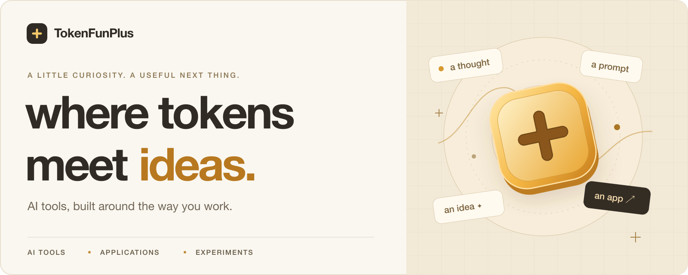
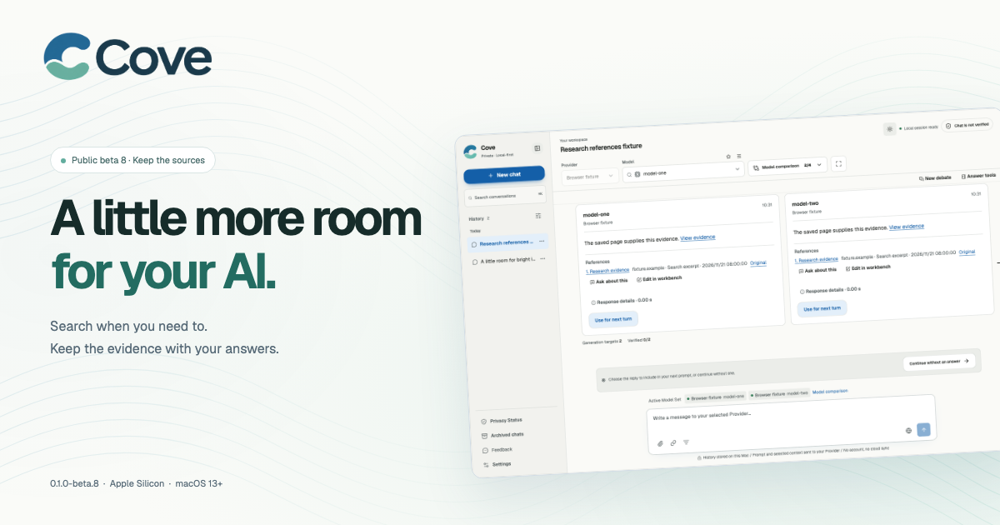
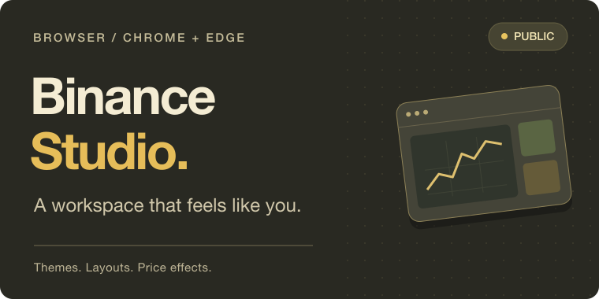

  

  <a href="https://tokenfunplus.github.io/"><b>Website</b></a> &nbsp;·&nbsp;
  <a href="#what-were-building"><b>Our projects</b></a> &nbsp;·&nbsp;
  <a href="https://github.com/tokenfunplus/cove/releases/tag/v0.1.0-beta.8"><b>Download Cove</b></a> &nbsp;·&nbsp;
  <a href="#build-with-us"><b>Build with us</b></a>

**We build AI tools and applications that turn ideas into everyday experiences.** Our current focus is Cove, a local-first AI chat app for Mac. Along the way, we make smaller tools for more personal, useful workspaces.

## What we're building

### Cove

**AI chat for Mac · Public beta**

Your models and saved sources, in one workspace. Compare up to four answers, research a question, explore a selected passage, and review revisions in the answer workbench.

**New in Beta 8:**

- Turn on the globe to let a compatible model search when needed. New conversations start with Web search off; you can also read a public webpage explicitly and preview its extracted text.
- Configure Tavily, Linkup, or Exa separately from your model provider. Search keys use macOS Keychain, and each model response has its own search and page-read limits.
- Follow inline citations and References to saved evidence. Search excerpts stay distinct from full page reads, and saved sources follow retries, branches, and exports. A citation identifies a source; it does not verify a claim.

Continuous debates, cited stage summaries, usage estimates, budget controls, and pacing remain available.

File chat, local search, model filters, reasoning views, four workspace skins, and locally rendered equations remain available. Working Drafts stay in window memory; download important drafts as Markdown.

Conversations and source files are stored on your Mac. Timeline bookmarks stay in the browser profile where they were saved. Prompts, selected context, and extracted source text go to your chosen provider. Web search queries go to the configured search service and page reads contact source websites, outside NearAI encrypted inference. Request limits count calls rather than provider credits. See the [privacy and trust model](https://github.com/tokenfunplus/cove/blob/main/docs/privacy.md).

**0.1.0-beta.8 · Apple Silicon · macOS 13+**

[**Explore Cove ↗**](https://www.hicove.io/) &nbsp;·&nbsp; [**Download beta ↓**](https://github.com/tokenfunplus/cove/releases/download/v0.1.0-beta.8/Cove-0.1.0-beta.8-arm64.dmg) &nbsp;·&nbsp; [**Source code ↗**](https://github.com/tokenfunplus/cove)

The published DMG is Developer ID signed and Apple notarized. See the [Beta 8 release notes and checksums](https://github.com/tokenfunplus/cove/releases/tag/v0.1.0-beta.8), including schema 22 upgrade and rollback guidance. Detached publisher signatures accompany the download.

### Binance Studio

**Browser extension · Public**

Personalize Binance Global with themes, layouts, and price effects. A Chrome / Edge extension; no API key required.

[**Explore Binance Studio ↗**](https://tokenfunplus.github.io/binance-studio/) &nbsp;·&nbsp; [**Source code ↗**](https://github.com/tokenfunplus/binance-theme)

## Find your starting point

| I want to… | Start here |
| :--- | :--- |
| Try Cove on my Mac | [Download the public beta](https://github.com/tokenfunplus/cove/releases/tag/v0.1.0-beta.8) · Apple Silicon, macOS 13+ |
| See Cove in action | [Explore the workflows](https://www.hicove.io/examples) · [Try the browser demo](https://www.hicove.io/app) with sample answers |
| Get started or explore the starter-key offer | [Cove setup and NEAR AI starter guide](https://www.hicove.io/starter) |
| Research a question with sources | [Web search and saved evidence](https://github.com/tokenfunplus/cove/blob/main/docs/user-guide.md#let-a-model-search-the-web) |
| Learn Cove or configure a debate | [User guide](https://github.com/tokenfunplus/cove/blob/main/docs/user-guide.md) · [Debate, summaries, budgets, and pacing](https://github.com/tokenfunplus/cove/blob/main/docs/debate.md) |
| Customize my Binance workspace | [Binance Studio installation guide](https://tokenfunplus.github.io/binance-studio/#install) |
| Explore what's open | [Browse our public repositories](https://github.com/orgs/tokenfunplus/repositories?type=public) |
| Report a bug or suggest an improvement | [Cove issues](https://github.com/tokenfunplus/cove/issues) · [Binance Studio issues](https://github.com/tokenfunplus/binance-theme/issues) |

## Build with us

Have an idea, found a rough edge, or made something better? Open an issue or pull request in the relevant repository. Start with the contribution guide for [Cove](https://github.com/tokenfunplus/cove/blob/main/CONTRIBUTING.md) or [Binance Studio](https://github.com/tokenfunplus/binance-theme/blob/main/CONTRIBUTING.md).

For Cove setup questions and community conversation, join the [Cove Discord](https://discord.gg/7jdddhG8ZG).

Binance Studio is an independent community project and is not affiliated with Binance.

---

<b>where tokens meet ideas.</b> TokenFunPlus

